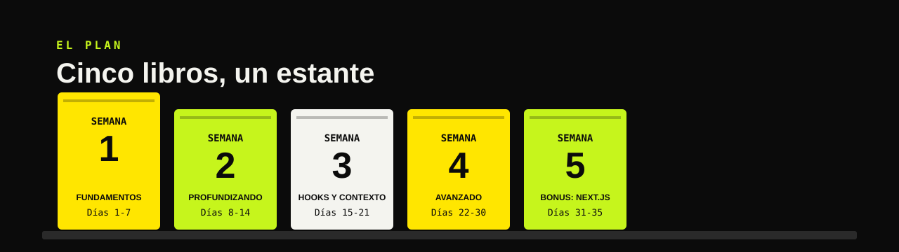

<p align="center">
  
</p>

<p align="center">
  <a href="https://github.com/nandomunoz/react-para-torpes/actions/workflows/ci.yml"></a>
  
  
  
  
  
  <a href="LICENSE"></a>
</p>

<p align="center">
  <strong>Un concepto por día. Código que corre en el navegador. Errores típicos explicados.</strong>
</p>

---

## Qué es

**React para torpes** es un curso gratuito y en español para aprender **React 19 con TypeScript** en 30 días, más una semana extra de **Next.js**. Está pensado para quien empieza desde cero y quiere avanzar sin agobios.

El repositorio incluye el curso y el sitio web que lo sirve:

- **31 lecciones** en MDX, con concepto, pasos numerados, error típico, ejercicio y solución.
- **Editor en vivo** en cada lección: cambias el código y ves el resultado al instante.
- **Ejemplos reales** que se compilan y se prueban en CI, así que el código del sitio nunca se desactualiza.
- **Landing interactiva** con progreso guardado en tu navegador, sin registro ni cookies.

## El plan

<p align="center">
  
</p>

| Semana | Días | Tema | Lo que construyes |
| --- | --- | --- | --- |
| 1 | 1 a 7 | Fundamentos | Entorno con Vite, JSX, props, `useState`, eventos y una lista de tareas |
| 2 | 8 a 14 | Profundizando | Listas, formularios con validación, elevación de estado y un proyecto con persistencia |
| 3 | 15 a 21 | Hooks y contexto | `useEffect`, hooks propios, Context, `useReducer`, `useMemo` y un glosario con paginación |
| 4 | 22 a 30 | Avanzado | React Router, Redux Toolkit, APIs, tests con Vitest y un CRUD final |
| 5 | 31 a 35 | Bonus: Next.js | App Router, Server Components, datos en servidor y despliegue estático |

Cada lección sigue el mismo formato:

1. **Concepto**, con una analogía cotidiana.
2. **Paso a paso**, en pasos numerados.
3. **Pruébalo en vivo**, con el editor al lado.
4. **Error típico**, antes de que tropieces con él.
5. **Ejercicio** con criterios que marcas tú, y su solución oculta.
6. **Resumen** y lecturas de la documentación oficial.

## Empezar

Requisitos: Node 20 o superior y [pnpm](https://pnpm.io).

```bash
pnpm install
pnpm dev          # sitio en http://localhost:3000
pnpm examples     # galería de ejemplos con Vite
```

Otros comandos útiles:

```bash
pnpm typecheck    # TypeScript en todo el monorepo
pnpm lint
pnpm test         # tests de los ejemplos y del sitio
pnpm build        # genera web/out, el sitio estático
pnpm --filter web check:content   # valida frontmatter, MDX y ejemplos referenciados
```

## Estructura

```
content/     lecciones en MDX (content/semanaN/dia-XX.mdx)
examples/    proyecto Vite con todos los ejemplos y sus tests
web/         sitio Next.js (App Router, export estático) con Tailwind CSS
docs/        recursos gráficos del repositorio
```

Los fragmentos que ves en el sitio se leen directamente de `examples/src`. Si un ejemplo deja de compilar, falla el CI.

## Tecnología

| Capa | Herramientas |
| --- | --- |
| Sitio | Next.js 16 (App Router, export estático), React 19, TypeScript |
| Estilos | Tailwind CSS 4 con tokens en `@theme`, tema oscuro |
| Contenido | MDX con `next-mdx-remote`, resaltado con Shiki |
| Editor en vivo | Sandpack |
| Ejemplos | Vite, React Router, Redux Toolkit |
| Calidad | ESLint, Vitest, Testing Library, GitHub Actions |
| Gestor de paquetes | pnpm workspaces |

## Despliegue

El sitio se exporta como HTML estático y [`deploy.yml`](.github/workflows/deploy.yml) lo publica en GitHub Pages con `NEXT_PUBLIC_BASE_PATH=/react-para-torpes`. Para activarlo, elige **GitHub Actions** como fuente en los ajustes de Pages del repositorio.

## Contribuir

Las correcciones de contenido, los ejemplos nuevos y las mejoras del sitio son bienvenidas. Lee [CONTRIBUTING.md](CONTRIBUTING.md) para ver el flujo de trabajo y el formato de las lecciones.

## Licencia

[MIT](LICENSE)
